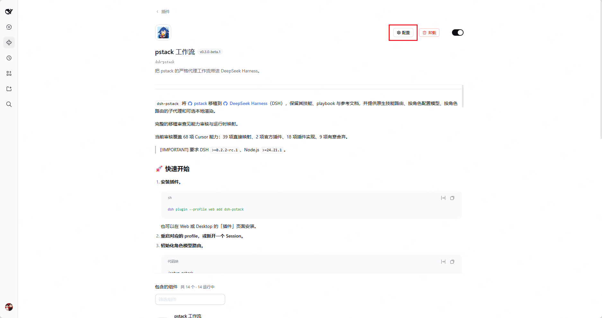
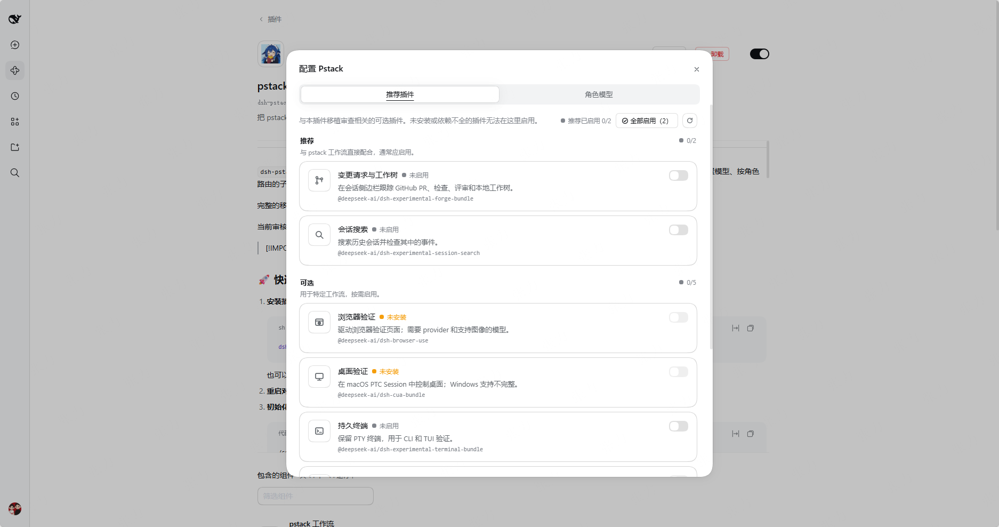
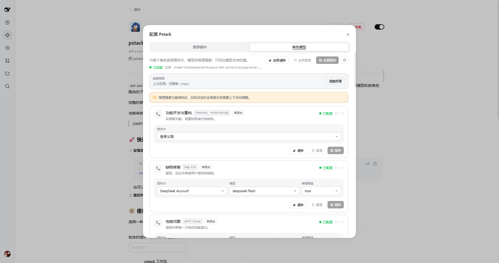
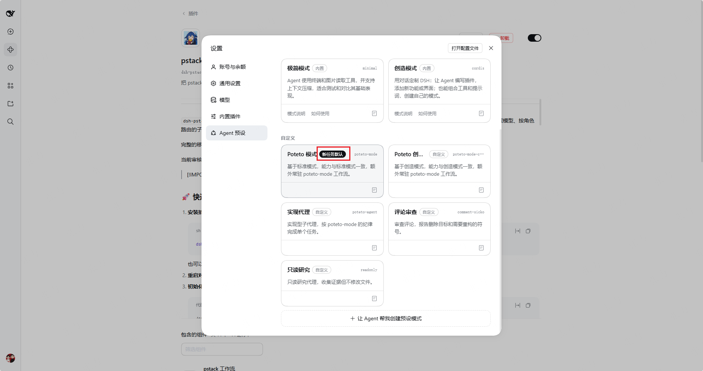
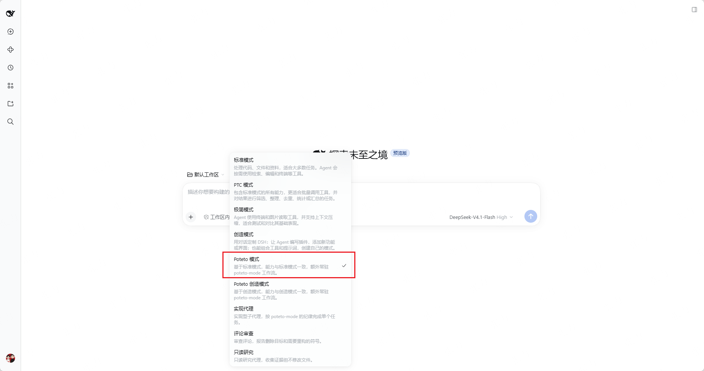

<div align="center">
  

  <h1>dsh-pstack</h1>

  <p>
    <strong>Bring pstack's rigorous agent workflows to DeepSeek Harness</strong>
  </p>

  <p>English · <a href="./README.zh.md">中文</a></p>

  <p>
    <a href="https://npmx.dev/package/dsh-pstack"></a>
    <a href="https://github.com/deepseek-ai/deepseek-harness">=0.2.2-rc.1" /></a>
    <a href="https://github.com/cursor/plugins/tree/main/pstack"></a>
    <a href="https://github.com/l246804/dsh-pstack/blob/main/LICENSE"></a>
    <a href="https://www.jsdocs.io/package/dsh-pstack"></a>
  </p>

  <table>
    <tr>
      <td align="center"><strong>58</strong><br /><sub>pstack skills</sub></td>
      <td align="center"><strong>23</strong><br /><sub>playbooks</sub></td>
      <td align="center"><strong>4</strong><br /><sub>native tools</sub></td>
      <td align="center"><strong>5</strong><br /><sub>agent presets</sub></td>
      <td align="center"><strong>5</strong><br /><sub>bundled scripts</sub></td>
    </tr>
  </table>

  <p>
    <a href="#quick-start">🚀 Quick start</a> ·
    <a href="#️-common-commands">⌨️ Commands</a> ·
    <a href="#-capabilities">🧩 Capabilities</a> ·
    <a href="#-optional-dsh-plugins">🔌 Optional plugins</a> ·
    <a href="#️-remaining-gaps">⚠️ Limitations</a> ·
    <a href="#-compatibility">📦 Compatibility</a>
  </p>
</div>

---

`dsh-pstack` ports [pstack](https://github.com/cursor/plugins/tree/main/pstack) to [DeepSeek Harness](https://github.com/deepseek-ai/deepseek-harness) (DSH). It includes the upstream skills, playbooks, and references, and adds skill routing, role-based model configuration, and role-routed subagents.

See the [capability audit (in Chinese)](./port/audit.md) and [runtime mapping](./port/dsh.md) for the complete porting review.

The current review covers 68 Cursor-facing capabilities: 39 direct mappings, 2 official plugins, 16 plugin implementations, and 11 deliberate omissions.

> [!IMPORTANT]
> Requires DSH `>=0.2.2-rc.1` and Node.js `>=24.21.1`.

<a id="quick-start"></a>

## 🚀 Quick start

1. **Install the plugin.**

   ```sh
   dsh plugin --profile web add dsh-pstack
   ```

   You can also install it through **Plugins** in Web or Desktop.

2. **Restart the profile or open a new Session.**

## 🧭 Usage

Choose one of the two paths and expand it for the full steps.

<details>
<summary><strong>🖥️ Visual setup</strong></summary>

Use the plugin UI when you want to configure related plugins and role routes.

1. Open **Plugins → Installed plugins**, select **pstack workflow**, then click **Configure**.

   

2. In **Recommended plugins**, review the **Recommended**, **Optional**, and **Conflicts** groups. **Enable all** enables only the recommended group.

   

3. Open **Role models**, set the provider, model, and reasoning effort for each role, then save the changed row or use **Save all**.

   

4. Open **Settings → Agent presets**, select **Poteto mode** or **Poteto Creator mode**, and click **Set as default**.

   

5. When creating a Session, keep the default preset or select **Poteto mode** manually.

   

</details>

<details>
<summary><strong>🧠 Skill usage</strong></summary>

Use pstack skills when you want to start workflows directly from a Session.

1. **Initialize role routes.** Run `/setup-pstack` once. It writes available routes to `$DSH_HOME/pstack-models.mdc`. Without this file, roles inherit the parent model.
2. **Start through skills.** Type `/poteto-mode` directly. A preset switch is not required first.
3. **Use targeted commands.** Pick a command from [Common commands](#️-common-commands).

</details>

## ⌨️ Common commands

| Task | Commands |
|---|---|
| Help | `/poteto-help` |
| Plan and build | `/poteto-mode`, `/architect`, `/arena`, `/swarm` |
| Understand and investigate | `/how`, `/why`, `/teach` |
| Verify | `/create-verification-skill`, `/statechart` |
| Review and maintain | `/show-me-your-work`, `/retro`, `/docs-drift` |

## 🧩 Capabilities

### 🛠️ Native tools

| Tool | Function |
|---|---|
| `pstack_skill` | Loads hidden pstack skills and their relative resources by name. |
| `pstack_models` | Lists available providers, models, and reasoning efforts. |
| `pstack_roles` | Shows role shapes and automatic-panel status so delegation uses the correct parameters. |
| `pstack_subagent` | Applies role routing and agent presets. Supports parallel subagents. |

### 🎭 Agent presets

The package ships two root presets and three child presets.

| Preset | Scope | Use |
|---|---|---|
| `poteto-mode` | Root | Based on Standard mode, with the same capabilities plus the persistent `poteto-mode` workflow. |
| `poteto-mode-creator` | Root | Based on Creator mode, with the same capabilities plus the persistent `poteto-mode` workflow. |
| `poteto-agent` | Child | Handles implementation delegation with the pstack persona and `poteto-mode` instructions. |
| `comment-sicko` | Child | Handles read-only comment review and reports deletion targets and `MUST KILL` symbols. |
| `readonly` | Child | Provides sandbox-enforced read-only research for inspection and evidence gathering. |

Open **Settings → Agent presets** and click **Set as default** on the preset new Sessions should use.

### 📚 Additional skills

These skills fill gaps that pstack leaves in real projects. They are not part of the upstream pstack skill tree. They cover skill authoring, project documentation, evidence capture, decision records, and cleanup workflows.

| Skill | Source | Gap it fills |
|---|---|---|
| `writing-for-agents` | `vendored` | Turns a working practice into a reusable skill or clear agent-facing document, replacing upstream `create-skill`. |
| `retro` | `vendored` | Runs a read-only retrospective on the agent environment when pstack has no project-level review pass. |
| `deslop` | `vendored` | Cleans AI-generated noise from a diff before commit or review. |
| `control-ui` | `vendored` | Drives a real local Web, IDE, or Electron UI when pstack needs browser-level evidence. |
| `control-cli` | `vendored` | Drives interactive CLI or TUI sessions when pstack needs terminal-level evidence. |
| `decision-write` | `authored` | Records decisions that would otherwise stay buried in chat. |
| `decision-audit` | `authored` | Checks decision-record status and links when a project accumulates design history. |
| `setup-project-docs` | `authored` | Bootstraps durable project documentation when the repository has none. |
| `docs-drift` | `authored` | Finds and repairs documentation drift as code changes. |

[`skills/skills-lock.json`](./skills/skills-lock.json) records the sources and hashes of vendored skills.

## 🔌 Optional DSH plugins

Optional plugins extend specific workflows. You do not need them to install dsh-pstack.

To enable a plugin, open **Plugins → Add plugin**, select the package, and restart the profile.

| Use case | Plugin | Limits and conflicts |
|---|---|---|
| Worktrees and GitHub PRs | `@deepseek-ai/dsh-experimental-forge-bundle` | Provides the **Change requests & worktrees** switch and `create_worktree`. GitHub status needs a logged-in `gh`. |
| Session history | `@deepseek-ai/dsh-experimental-session-search` | Read-only. Requires exact `cwd` equality. Subagent transcript coverage is unconfirmed. |
| Browser verification | `@deepseek-ai/dsh-browser-use` and one provider | One provider per Session. Screenshots need an image-capable model. No video recording. |
| Desktop verification | `@deepseek-ai/dsh-cua-bundle` | macOS PTC Sessions only. Windows support is incomplete. No video recording. |
| Persistent terminals | `@deepseek-ai/dsh-experimental-terminal-bundle` | Six persistent shell and REPL tools. No GUI control or video recording. |
| MCP integrations | `@deepseek-ai/dsh-mcp-client` | No server configured by default. No automatic evidence-category discovery. |
| Autonomous loops | `@deepseek-ai/dsh-experimental-ralph-bundle` | Starts a fresh child each round. No persistent loop or event watcher. |

Most packages ship with DSH. `@deepseek-ai/dsh-cua-bundle` installs on demand. Except for the MCP client, these plugins are experimental.

### ⚠️ Agent Teams conflict

> [!WARNING]
> **Do not enable Agent Teams with either pstack root preset.** Use either Agent Teams or `pstack_subagent`, not both. Enabling Agent Teams makes the pstack root preset fail at startup and disables DSH native subagent tools.

### 🌐 Browser providers

Choose one provider for `@deepseek-ai/dsh-browser-use`:

- `@deepseek-ai/dsh-experimental-browser-use-stagehand-native`: also needs Chromium and a supported non-DeepSeek model.
- `@deepseek-ai/dsh-experimental-browser-use-playwright-mcp`
- `@deepseek-ai/dsh-experimental-browser-use-chrome-devtools-mcp`

Providers have different tool names and selectors. Browser and computer use share separate single-provider slots.

The configuration page recommends Change requests & worktrees and session search. It never enables plugins automatically.

When a plugin is disabled, dependent steps report skipped or blocked. They never report passed. Without the forge bundle, use `gh` and `git worktree add` through `bash`. See the [DSH adaptation guide](./pstack/docs/harness/dsh.md#optional-plugins) for setup details and fallbacks.

## ⚠️ Remaining gaps

These limitations remain even when every recommended plugin is enabled.

| Area | Limitation |
|---|---|
| Cursor platform services | No Automations, Cursor webhooks, `SendToUser`, cloud agents, or persistent cloud Projects. |
| Bugbot | Cannot start, configure, or wait for Bugbot. Existing Bugbot comments can still be handled as PR reviews. |
| PR orchestration | No model-side change-request tool or Agent Teams PR frontier and ledger. `watch-pr` still provides stack verdicts. |
| Mode switching | No Option+Enter toggle or mid-session mode switch. Select `poteto-mode` or `poteto-mode-creator` at session creation; other presets invoke `/poteto-mode` for each task. |
| Event-driven loops | No forge event subscription. Local goals, schedules, and watchers are not equivalent. |
| Diagram rendering | No built-in renderer. Charts return Mermaid text; render an image with your own tools when needed. |
| Media evidence | No built-in video rendering, recording, or frame-level verification. Use external recording or FFmpeg tools. |
| Desktop coverage | Computer use is limited to macOS PTC Sessions. Windows support is incomplete. |
| MCP discovery | No automatic evidence-category discovery. Configure and identify MCP tools explicitly. |

Node.js is the plugin baseline. `watch-pr` also needs Bun, network access, and a logged-in `gh`. `statechart` also needs Node, Bun, or Deno, plus mise, Java, TLC, and network on first run. See the [script registry](./port/README.md#脚本登记) for details.

## 📦 Compatibility

Each row lists the latest compatible dsh-pstack release and its included pstack version.

| DSH version | Latest compatible dsh-pstack release | Included pstack version |
|---|---|---|
| `0.2.2-rc.1` and later | `0.3.0-beta.1` | `0.15.36` |

When a DSH breaking change creates a new compatibility boundary, add a row.

## 💛 Credits

- [pstack](https://github.com/cursor/plugins/tree/main/pstack) was designed and open-sourced by Lauren Tan and the Cursor team. `poteto-mode`, the 23 playbooks, and the 24 principles come from upstream.
- [DeepSeek Harness](https://github.com/deepseek-ai/deepseek-harness) is provided by the DeepSeek team. Its plugin, bundle, agent preset, subagent, and tool interfaces support this port.
- [cursor/plugins `cursor-team-kit`](https://github.com/cursor/plugins/tree/main/cursor-team-kit) provides the vendored `deslop`, `control-ui`, and `control-cli` skills.
- [mattpocock/skills](https://github.com/mattpocock/skills) provides the vendored `writing-for-agents` and `retro` skills.

This project is a community port, not an official Cursor or DeepSeek release.

## 📄 License

Original dsh-pstack code and documentation use the [MIT license](./LICENSE) © [leiwang](https://github.com/l246804). Bundled upstream projects and vendored skills retain their licenses and notices.
